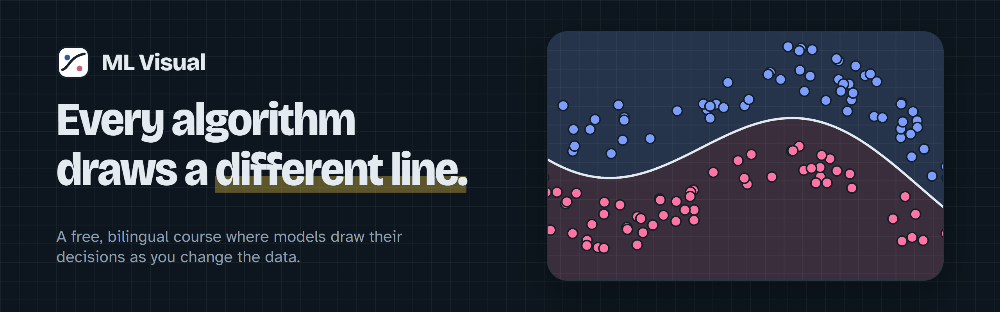
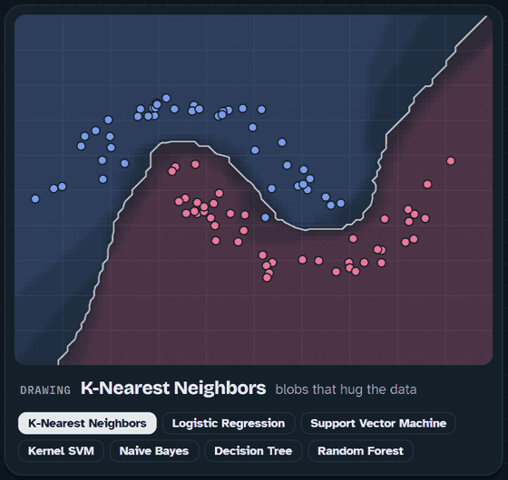
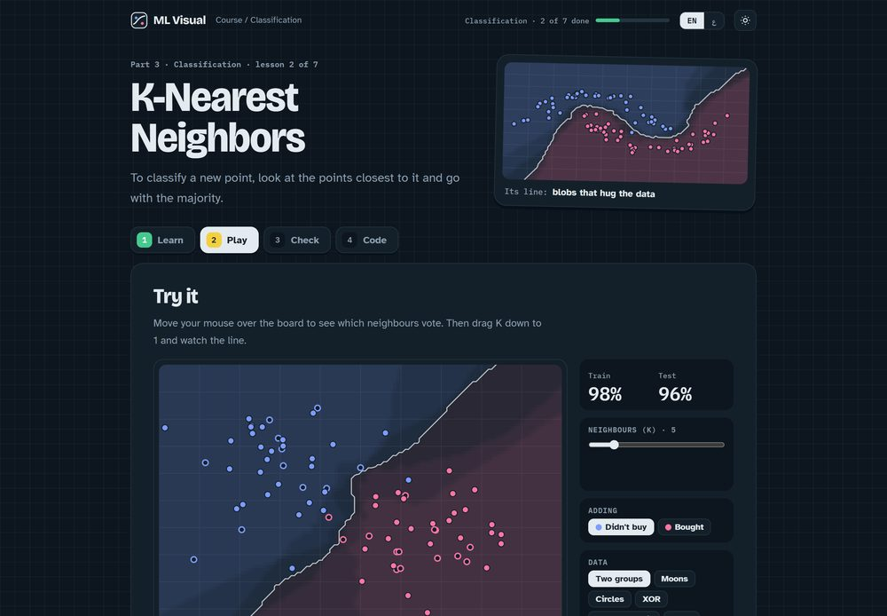
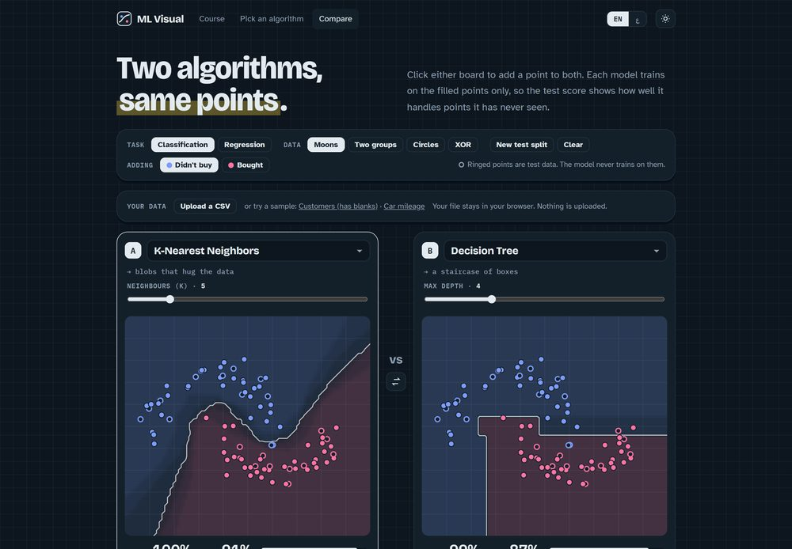
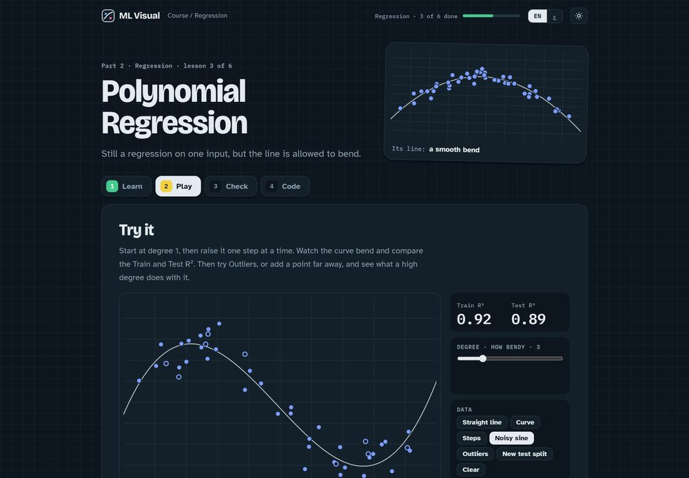
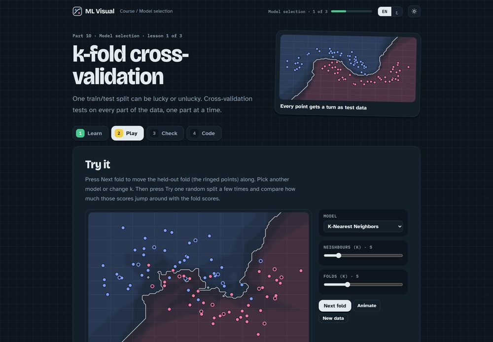
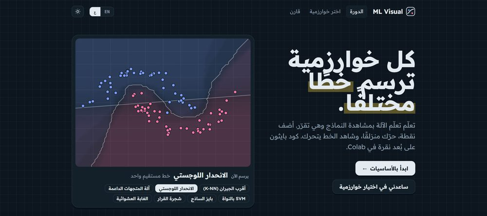
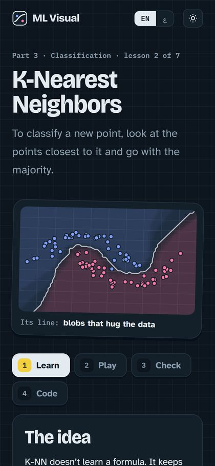
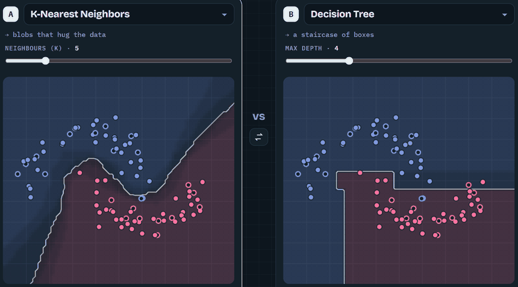

<div align="center">

<a href="https://mohammad-qt.github.io/ML_DL_Vis/">
  <picture>
    <source media="(prefers-color-scheme: light)" srcset="docs/banner-light.png">
    
  </picture>
</a>

<br>

[](https://mohammad-qt.github.io/ML_DL_Vis/)
[](https://mohammad-qt.github.io/ML_DL_Vis/ar/)
[](https://astro.build)
[](notebooks/)
[](#copyright)

**[Open the site](https://mohammad-qt.github.io/ML_DL_Vis/)** · **[Compare two algorithms](https://mohammad-qt.github.io/ML_DL_Vis/compare/)** · **[بالعربية](https://mohammad-qt.github.io/ML_DL_Vis/ar/)**

</div>

<p align="center">
  
</p>

ML Visual is a free course in machine learning for beginners, in English and Arabic. Every lesson has a live board.
The models train in your browser and redraw their decision line the moment you add a point or move a setting.
There is nothing to install. When you want the code, each lesson opens its own notebook in Google Colab.

**On this page:** [Features](#-features) · [Inside the course](#inside-the-course) · [How a lesson works](#how-a-lesson-works) · [Run the code](#run-the-code) · [Run the site locally](#run-the-site-locally) · [Use it offline](#use-it-offline) · [Tech](#tech) · [Copyright](#copyright)

## ✦ Features

<table>
  <tr>
    <td width="33%" valign="top">
      <br>
      <b>Live boards</b><br>
      Real models, re-implemented in TypeScript. Drag a slider and the line moves.
    </td>
    <td width="33%" valign="top">
      <br>
      <b>Compare two algorithms</b><br>
      The same points, two models, train and test scores side by side.
    </td>
    <td width="33%" valign="top">
      <br>
      <b>Train vs test scores</b><br>
      Ringed points are held back, so overfitting shows up as a gap you can see.
    </td>
  </tr>
  <tr>
    <td width="33%" valign="top">
      <br>
      <b>Model selection</b><br>
      Step through k-fold folds and see how much one lucky split can mislead.
    </td>
    <td width="33%" valign="top">
      <br>
      <b>Arabic, right to left</b><br>
      The whole site is in Arabic. Dark is the default, with a light theme one tap away.
    </td>
    <td width="33%" valign="top" align="center">
      <br>
      <b>Phones and keyboards</b><br>
      Boards work by touch and by keyboard.
    </td>
  </tr>
</table>

You can also upload your own CSV on the Compare page. The file stays in your browser and nothing is sent anywhere.

<p align="center">
  
</p>

## Inside the course

| Part | Lessons |
|---|---|
| **0 · Start here** | How the site works, what Colab is, how to read a board |
| **1 · Prepare the data** | Missing values · Text categories · Train/test split · Feature scaling |
| **2 · Regression** | Simple linear · Multiple linear · Polynomial · SVR · Decision tree · Random forest |
| **3 · Classification** | Logistic regression · K-NN · SVM · Kernel SVM · Naive Bayes · Decision tree · Random forest |
| **10 · Pick the best model** | k-fold cross-validation · Grid search · Gradient boosting (XGBoost) |

Parts 4 to 9 (clustering, association rules, reinforcement learning, NLP, deep learning and dimensionality
reduction) come later.

## How a lesson works

| | Step | What you do |
|---|---|---|
| 1 | **Learn** | Read the idea in plain words, how the algorithm decides, and the one mistake to avoid |
| 2 | **Play** | Add points, pick a dataset, move a setting, and watch the train and test scores |
| 3 | **Check** | Answer a short quiz, predict the line, and try to beat the score |
| 4 | **Code** | Read the scikit-learn code and open the full notebook in Colab |

## Run the code

Every lesson has a notebook in [`notebooks/`](notebooks/). Three ways to use it:

- **Colab.** Press "Open in Colab" on the lesson's Code tab. Each notebook loads its data from [`datasets/`](datasets/) by link, so you upload nothing.
- **Download.** Save the `.ipynb` file from the lesson page or from this repository.
- **VS Code or Jupyter.** Open the downloaded file. You need Python with `pandas`, `scikit-learn` and `matplotlib`, plus `xgboost` for the boosting lesson.

The datasets are public or original to this project. Sources and licenses are in [`datasets/README.md`](datasets/README.md).

## Run the site locally

You need Node.js 22.23 or newer.

```bash
npm install
npm run dev      # http://localhost:4321/ML_DL_Vis/
npm test         # model and lesson tests
npm run build    # static site in dist/
```

## Use it offline

Offline use is being documented. This section will be filled in soon.

## Tech

[Astro](https://astro.build) and TypeScript, with the models written from scratch in [`src/engine/`](src/engine/) and covered by Vitest tests. It is a static site; pushing to `main` deploys it to GitHub Pages.

## Use it offline

The site is an installable app. Open it once while online, and every lesson, the fonts and the notebooks are saved
in your browser, so it keeps working without internet. In Chrome or Edge, use **Install the app** at the bottom of
the course menu on any lesson page (or the install icon in the address bar). Your progress stays in that browser.

To run your own copy offline from this repository:

```bash
npm install
npm run build && npm run preview   # http://localhost:4321/ML_DL_Vis/
```

Notebooks still read their data from GitHub. To run them with no internet at all, download
[`datasets/`](datasets/) too and point the notebook at the local file.

## Copyright

© 2026 Mohammad Ismael Al-Qatameen. All rights reserved.

The lessons, code, notebooks and design in this repository may not be copied or republished without permission.
Datasets keep their own licenses, listed in [`datasets/README.md`](datasets/README.md).
