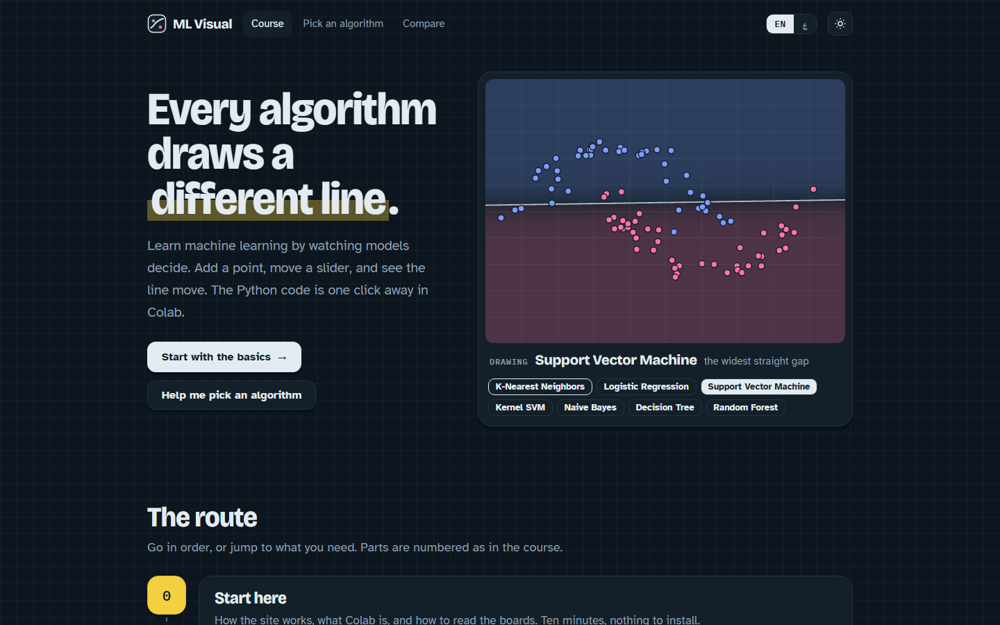
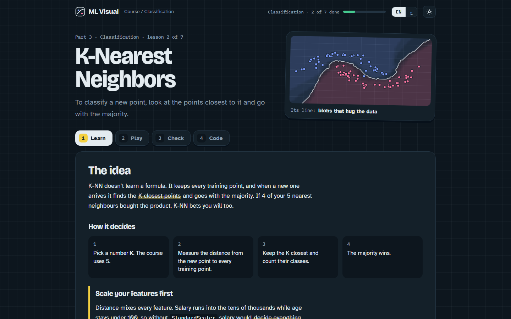
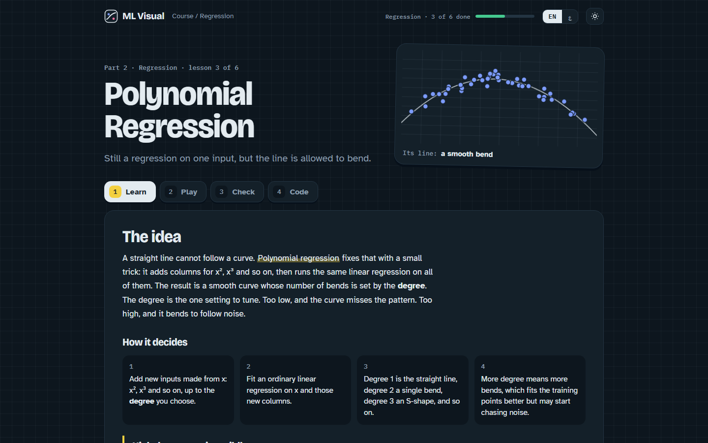
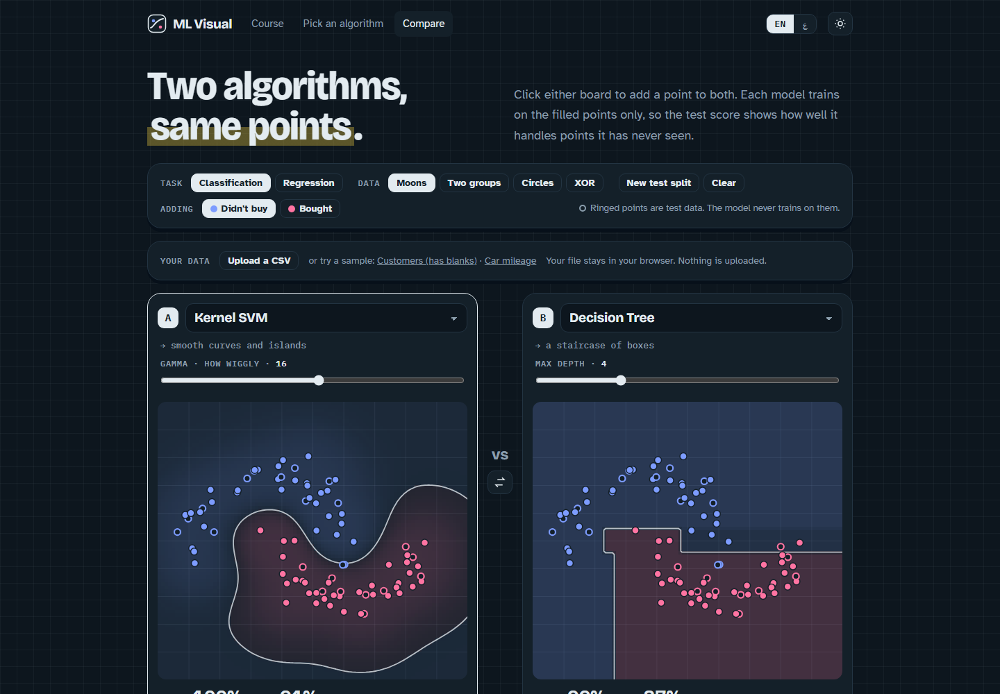
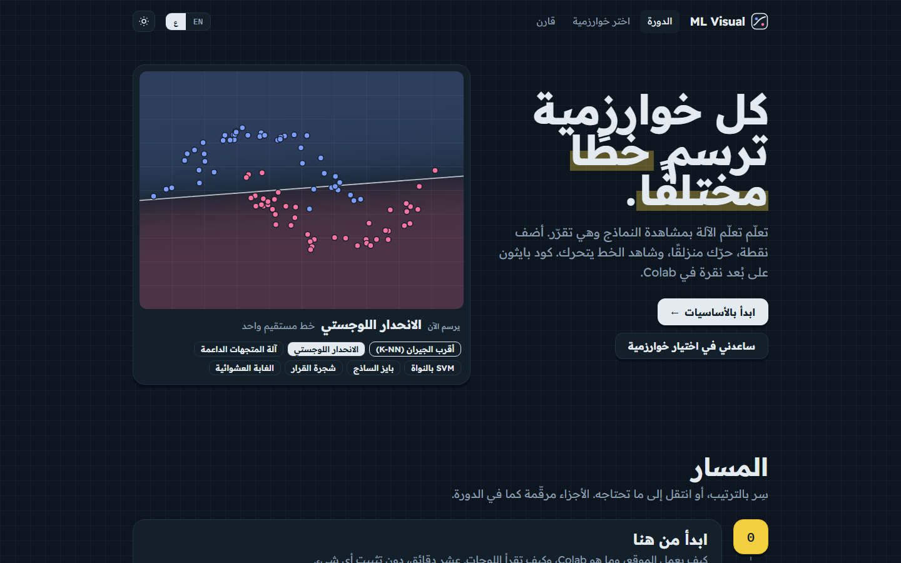
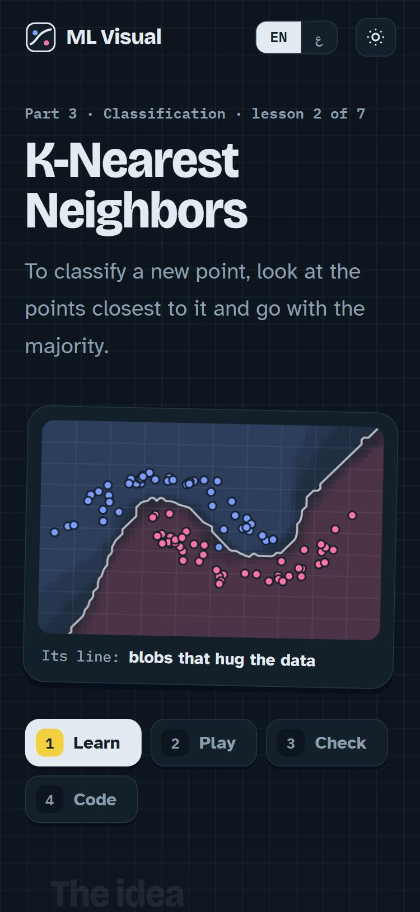

<div align="center">

# ML Visual

**Every algorithm draws a different line.**

Learn machine learning by watching models decide. Add a point, move a slider, and see the line move.
The Python code is one click away in Google Colab.

[**Open the site →**](https://mohammad-qt.github.io/ML_DL_Vis/) &nbsp;·&nbsp; [الموقع بالعربية](https://mohammad-qt.github.io/ML_DL_Vis/ar/) &nbsp;·&nbsp; [Compare two algorithms](https://mohammad-qt.github.io/ML_DL_Vis/compare/)

<br>



</div>

## What it is

ML Visual is a free, bilingual (English and Arabic) course for beginners. It covers preprocessing, regression,
classification and model selection. Every lesson has a live board: the models are real, they train in your
browser, and they redraw their decision line the moment you add a point or change a setting.

There's nothing to install. When you want the code, each lesson opens its own notebook in Google Colab, already
connected to its dataset.

## How a lesson works

Each lesson moves through four steps:

| Step | What you do |
|---|---|
| **Learn** | The idea in plain words, how the algorithm decides, and the one mistake to avoid |
| **Play** | Add points, pick a dataset, move the setting, and watch the train and test scores |
| **Check** | A quick quiz, "predict the line", and "beat the score" challenges |
| **Code** | The scikit-learn code, plus a button that opens the full notebook in Colab |

<p align="center">
  
  
</p>

## Compare two algorithms

Put two algorithms side by side on the same points. Ringed points are held back as test data, so the scores
show which model handles points it has never seen, and when one of them is just memorising.
You can also upload your own CSV. It stays in your browser and nothing is sent anywhere.

<p align="center">
  
</p>

## Arabic, dark mode and phones

The whole site is available in Arabic, laid out right to left. Dark mode is the default, with a light theme one tap
away. Every board also works by touch on a phone and by keyboard.

<p align="center">
  
  
</p>

## What's inside

| Part | Lessons |
|---|---|
| **0 · Start here** | How the site works, reading a board, using Colab |
| **1 · Prepare the data** | Missing values · Text categories · Train/test split · Feature scaling |
| **2 · Regression** | Simple linear · Multiple linear · Polynomial · SVR · Decision tree · Random forest |
| **3 · Classification** | Logistic regression · K-NN · SVM · Kernel SVM · Naive Bayes · Decision tree · Random forest |
| **10 · Pick the best model** | k-fold cross-validation · Grid search · Gradient boosting (XGBoost) |

Parts 4–9 (clustering, association rules, reinforcement learning, NLP, deep learning and dimensionality
reduction) will come later.

## Notebooks

Every lesson has a notebook in [`notebooks/`](notebooks/). Open it in Colab from the lesson page, or download it and
run it in VS Code or Jupyter. Running it locally needs Python with `pandas`, `scikit-learn` and `matplotlib`,
plus `xgboost` for the boosting lesson. Each notebook loads its data from [`datasets/`](datasets/) by link, so you
don't need to upload anything. The datasets are public or original to this project; sources and licenses
are in [`datasets/README.md`](datasets/README.md).

## Run the site locally

You need Node.js 22.23 or newer.

```bash
npm install
npm run dev      # http://localhost:4321/ML_DL_Vis/
npm test         # model and lesson tests
npm run build    # static site in dist/
```

Built with [Astro](https://astro.build) and TypeScript. The models in [`src/engine/`](src/engine/) are written from
scratch and run in the browser. Pushing to `main` deploys to GitHub Pages.

## Copyright

© 2026 Mohammad Ismael Al-Qatameen. All rights reserved.

The lessons, code, notebooks and design in this repository may not be copied or republished without permission.
Datasets keep their own licenses, listed in [`datasets/README.md`](datasets/README.md).
